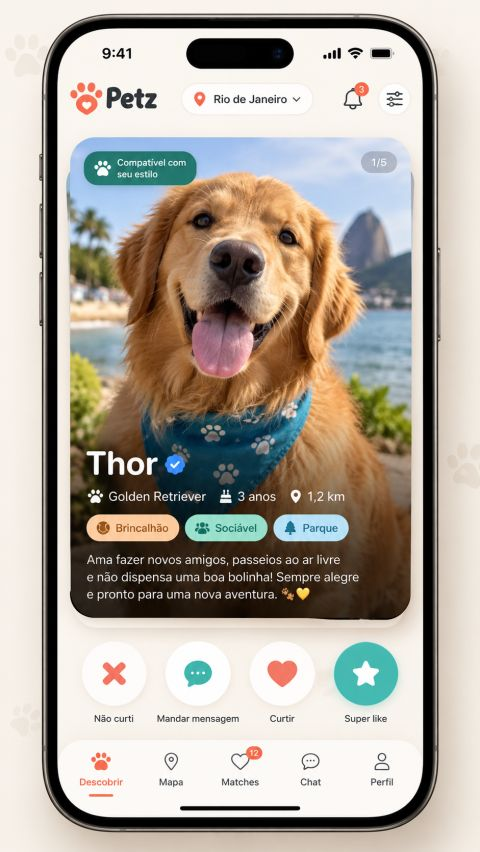
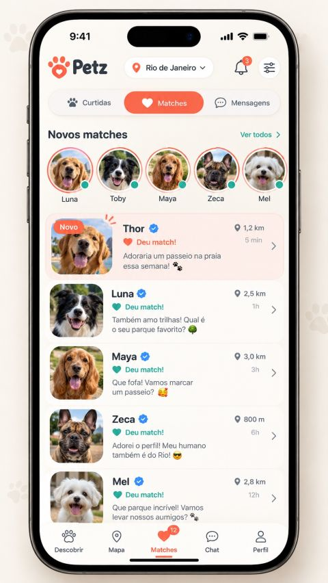
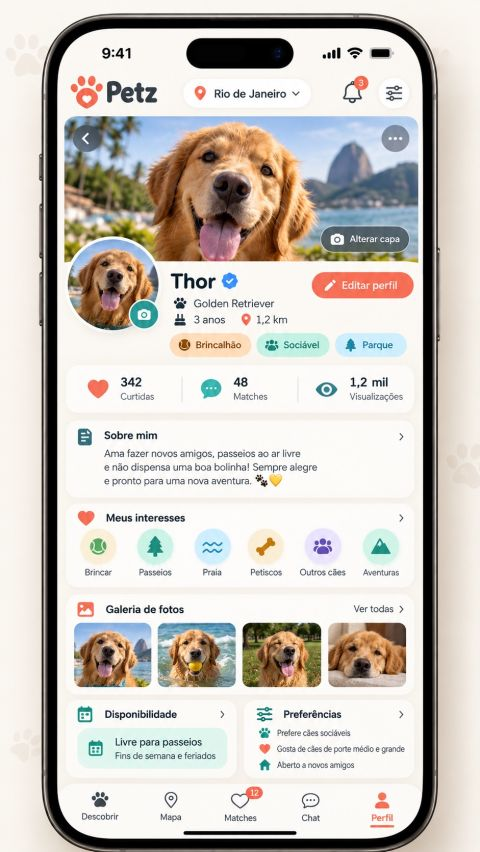

# Petz 🐾

A social app for pets and their owners. Create profiles for your pets, discover pets nearby, match, chat and set up walks in public places.

<p align="center">
  
  
  
</p>

The app's interface is in Brazilian Portuguese. The repository has two parts:

| Folder                 | What it is                                                               |
| ---------------------- | ------------------------------------------------------------------------ |
| [`app/`](app/)         | Mobile app built with React Native + Expo (iOS and Android)              |
| [`backend/`](backend/) | REST API built with Fastify + TypeScript, on Postgres/PostGIS (Supabase) |

## Features

- **Sign in** with Apple, Google or email (Clerk).
- **Onboarding and pet profile:** species, breed, age, size, personality, interests, walk availability, preferences and a photo gallery.
- **Discover:** swipeable cards (like, pass, super like), ranked by distance, compatibility and recent activity, with filters.
- **Matches:** a mutual like (or a returned super like) creates a match and opens a conversation.
- **Real-time chat:** text messages, read receipts and walk invites that the other owner can accept or decline.
- **Walks:** upcoming and recent invites, grouped by status.
- **Map:** pets nearby, shown at an approximate location.
- **Push notifications** for new matches and messages.
- **Safety:** report and block. Blocking hides the owner on every screen, both ways.
- **Premium:** more than one pet, unmatched pets on the map, direct messages without a match, advanced filters, profile boost and unlimited super likes (the free plan has 1 per day).
- **Account deletion:** removes the login, pets, photos, matches and messages.

## Privacy

Location is the most sensitive data in the app.

- The app rounds the GPS position to about 1 km right after reading it. The precise position never leaves the device.
- The API never returns real coordinates. It returns a rounded distance and a position shifted consistently for each pet (a grid of about 500 m).
- On the map, the user is shown as an area, not a point.
- Logs never contain coordinates.
- No screen shows an address or phone number, and the chat reminds owners to meet in public places.

## Tech stack

### App

| Area                | Technology                                         |
| ------------------- | -------------------------------------------------- |
| Framework           | React Native 0.86 + Expo SDK 57, strict TypeScript |
| Navigation          | Expo Router (typed routes)                         |
| Server state        | TanStack Query                                     |
| Local state         | Zustand                                            |
| Forms               | React Hook Form + Zod                              |
| Authentication      | Clerk (`@clerk/expo`)                              |
| Real time           | Supabase Realtime                                  |
| Map                 | Mapbox (`@rnmapbox/maps`)                          |
| Gestures and motion | Gesture Handler + Reanimated 4                     |
| Push                | Expo Notifications                                 |
| Tests               | Jest (`jest-expo`) + React Native Testing Library  |

### Backend

| Area              | Technology                                                         |
| ----------------- | ------------------------------------------------------------------ |
| Server            | Node.js 22+, Fastify 5, TypeScript                                 |
| Validation        | Zod (`fastify-type-provider-zod`), also used for the API docs      |
| Database          | Postgres + PostGIS on Supabase, via Drizzle ORM and postgres.js    |
| File storage      | Supabase Storage, uploaded directly by the app through signed URLs |
| Real time         | Supabase Realtime, protected by RLS using the Clerk session token  |
| Authentication    | Clerk (`@clerk/backend`), with webhooks verified by Svix           |
| Push              | Expo Push Service (`expo-server-sdk`)                              |
| API documentation | OpenAPI (`@fastify/swagger`), served at `/docs` outside production |
| Tests             | Vitest                                                             |

## Architecture

```
┌──────────────┐   REST /v1 (Clerk token)       ┌──────────────────┐
│  App (Expo)  │ ─────────────────────────────▶ │  API (Fastify)   │
│              │                                │                  │
│              │ ◀──── Realtime (read only) ─── │  Postgres/PostGIS│
│              │       Supabase + RLS           │  Storage, outbox │
│              │ ──── signed URL upload ──────▶ │  (Supabase)      │
└──────────────┘                                └──────────────────┘
        ▲                                                │
        └──────────── push (Expo Push Service) ◀──────────┘
```

- **The API is the source of truth.** Every write goes through it, so it enforces business rules, blocks, rate limits and premium access. The app never writes to Supabase directly.
- **Real time is read only.** The app listens to chat changes through Supabase Realtime, authenticated with the Clerk token. Row Level Security policies make sure only the participants of a conversation receive its messages.
- **Modular monolith.** Each backend module (`users`, `pets`, `discovery`, `likes`, `matches`, `conversations`, `blocks`, `reports`, `entitlements`, `notifications`...) follows the same split: routes, service and repository.
- **Outbox instead of a queue.** Events such as "new match" and "new message" are written to a table in the same transaction as the action. A worker in the same process sends the push notifications afterwards. No Redis needed.
- **Premium is enforced on the server.** The app shows or hides features for a better experience, but the API decides and answers `402 PREMIUM_REQUIRED`.
- **Mocks in the app.** Every call goes through the `PetzApi` interface. Without `EXPO_PUBLIC_API_URL`, the app uses an in-memory implementation with the same rules as the backend, which is handy for building screens without a server.

## Getting started

Requirements: Node.js 22.12 or newer (the app pins the version in [`app/.nvmrc`](app/.nvmrc)) and free accounts on [Supabase](https://supabase.com), [Clerk](https://clerk.com) and, for the map, [Mapbox](https://www.mapbox.com).

### Backend

```bash
cd backend
npm install
cp .env.example .env   # fill it in following the comments in the file
npm run db:migrate     # creates tables, extensions and policies on Supabase
npm run dev            # http://localhost:3000, API docs at /docs
```

To receive user data from the Clerk webhook during development, see [`backend/README.md`](backend/README.md#webhook-do-clerk-em-desenvolvimento).

### App

```bash
cd app
npm install
cp .env.example .env   # every variable is optional in development
npx expo start
```

With no variables set, the app starts with a development login and in-memory sample data. To use the backend, set `EXPO_PUBLIC_API_URL`.

The app runs in **Expo Go**, but the map and push notifications need a **development build**:

```bash
npx eas-cli@latest build --profile development --platform ios   # or android
```

Clerk, Mapbox and real-time setup are described in [`app/README.md`](app/README.md).

### Tests and checks

Both projects share the same command, which runs typecheck, lint and tests:

```bash
npm run check
```

- **Backend:** HTTP tests with `app.inject` and in-memory repositories.
- **App:** tests for screens, hooks, the HTTP client and the mock implementation, which also serves as a specification for the backend.

## Documentation

The detailed documents are in Portuguese.

| Document                                                                   | Contents                                    |
| -------------------------------------------------------------------------- | ------------------------------------------- |
| [`app/README.md`](app/README.md)                                           | App structure, environment variables, Clerk |
| [`backend/README.md`](backend/README.md)                                   | API structure, routes and photo uploads     |
| [`backend/doc/INITIAL_DECISIONS.md`](backend/doc/INITIAL_DECISIONS.md)     | Architecture and product decisions          |
| [`backend/doc/PENDING_VALIDATIONS.md`](backend/doc/PENDING_VALIDATIONS.md) | What still needs to be validated or decided |

## Contributing

Contributions are welcome.

1. Open an issue describing the bug or idea before starting anything large.
2. Create a branch from `main`.
3. Run `npm run check` in the folder you changed before opening a pull request.
4. Never commit `.env` files or keys. In the app, only public values (`EXPO_PUBLIC_*`) belong in the code.
